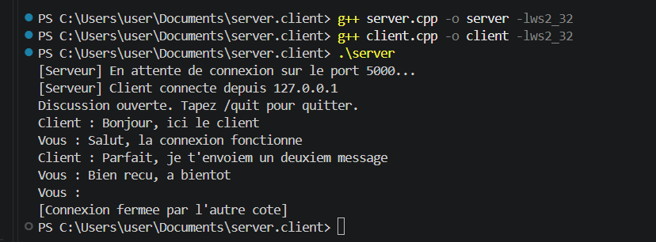
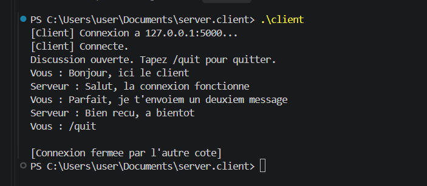

# Application de discussion client-serveur (C++)

Programme de messagerie en ligne de commande en C++ : un **serveur** et un **client** communiquent en temps réel via le protocole **TCP** (sockets).

## Fonctionnement

1. Le serveur écoute sur un port (5000 par défaut) et attend une connexion.
2. Le client se connecte à l'adresse IP et au port du serveur.
3. Une fois connectés, chaque côté peut envoyer et recevoir des messages en même temps.
4. Tapez `/quit` pour quitter.

## Fichiers

| Fichier | Rôle |
|---|---|
| `server.cpp` | Crée la socket, l'associe à un port (`bind`), écoute (`listen`) et accepte un client (`accept`) |
| `client.cpp` | Crée la socket et se connecte au serveur (`connect`) |
| `common.h` | Code commun : initialisation réseau, réception en thread séparé, boucle de discussion |

## Compilation

Sous Windows (MinGW / GCC) :

```
g++ server.cpp -o server -lws2_32
g++ client.cpp -o client -lws2_32
```

Sous Linux / macOS :

```
g++ server.cpp -o server -pthread
g++ client.cpp -o client -pthread
```

## Utilisation

Dans un premier terminal, lancer le serveur :

```
./server
```

Dans un second terminal, lancer le client :

```
./client
```

Pour utiliser un autre port, ou pour se connecter depuis un autre appareil du même réseau :

```
./server 6000
./client 192.168.1.10 6000
```

## Captures d'écran

### Côté serveur



### Côté client



## Concepts mis en œuvre

- Programmation réseau avec les **sockets TCP**
- Architecture **client-serveur**
- **Multithreading** : un thread reçoit pendant que le programme principal envoie
- Portabilité Windows (Winsock) / Linux (sockets POSIX) avec la compilation conditionnelle
- Gestion des erreurs (port occupé, serveur injoignable)

## Pistes d'amélioration

- Gestion de plusieurs clients en même temps (salon de discussion)
- Pseudonymes choisis par les utilisateurs
- Historique des messages enregistré dans un fichier
- Interface graphique

## Auteur
Cheikh Mohamed Asker Ahmed Aghmenane
